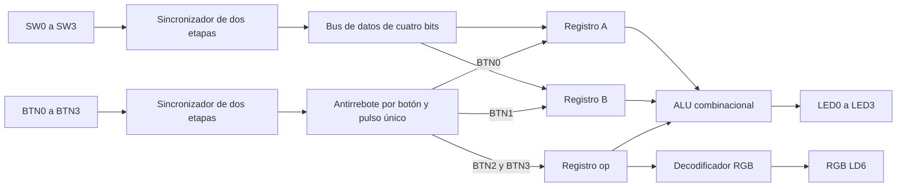

# Laboratorio 02 — ALU de 4 bits en Zybo Z7-10

Electrónica Digital II · Universidad Nacional de Colombia, sede Bogotá · 2026-2

| Integrante | Correo |
|---|---|
| Julián David Saavedra Pacheco | jusaavedrap@unal.edu.co |
| Juan Sebastián Cortés Gutiérrez | jcortesgu@unal.edu.co |
| Carlos Eduardo Matheus Quintero | cmatheus@unal.edu.co |

Repositorio de destino: [Lab02 del equipo](https://github.com/JulianDSPM-a/Lab02_JulianDavidSaavedraPacheco_JuanSebastianCortesGutierrez_CarlosEduardoMatheusQuintero). Esta entrega se preparó localmente; la publicación la realiza el equipo.

## Estado de la práctica

Reconstrucción desde cero conforme a la [guía oficial del lab02](https://github.com/jovelasquezs/2026-2_Lab_Electronica_Digital_2_G3yG4/tree/main/labs/lab02), consultada el **7 de octubre de 2026**. Se conserva una [copia de la guía](docs/guia_lab02_original.md) y una [matriz de cumplimiento](docs/matriz_cumplimiento.md).

- **Realizado:** HDL modular, asignación de pines, simulaciones con comprobaciones automáticas y VCD, síntesis, implementación, análisis temporal y generación del bitstream en Vivado 2025.2 para `xc7z010clg400-1`.
- **Pendiente:** abrir y capturar las ondas en GTKWave; programar y verificar una tarjeta física; incorporar fotos/video y completar el registro de laboratorio. El servicio de control de aplicaciones falló al intentar obtener las capturas. No se han sustituido por imágenes inventadas.

**Todavía no se afirma que la demostración física se haya realizado.** La generación del bitstream y la simulación son evidencias distintas de una prueba en la tarjeta.

## Contenido

1. [Funcionamiento y operaciones](#funcionamiento-y-operaciones)
2. [Arquitectura y módulos](#arquitectura-y-módulos)
3. [Almacenamiento y control](#almacenamiento-y-control)
4. [Cómo usar los códigos en el laboratorio](#cómo-usar-los-códigos-en-el-laboratorio)
5. [Simulaciones y análisis](#simulaciones-y-análisis)
6. [Implementación y resultados de Vivado](#implementación-y-resultados-de-vivado)
7. [Prueba física y evidencias](#prueba-física-y-evidencias)
8. [Conclusiones y referencias](#conclusiones-y-referencias)

## Funcionamiento y operaciones

La unidad aritmético-lógica recibe dos operandos A y B de cuatro bits y un código de operación de dos bits. El resultado también tiene cuatro bits. Los switches forman un bus compartido; dos registros externos a la ALU permiten introducir A y B en momentos diferentes. Otro registro almacena la operación. Así, los operandos y la selección permanecen aunque se cambien los switches o se suelten los botones.

| `op[1:0]` | Operación | Resultado `LED[3:0]` | Color LD6 | `{RGB_R,RGB_G,RGB_B}` |
|---|---|---|---|---|
| 00 | Suma | `(A + B) mod 16` | Verde | 010 |
| 01 | Resta | `(A - B) mod 16` | Rojo | 100 |
| 10 | AND bit a bit | `A & B` | Azul | 001 |
| 11 | OR bit a bit | `A \| B` | Amarillo | 110 |

Los operandos se interpretan como valores **sin signo entre 0 y 15**. No se generan banderas de acarreo, préstamo ni overflow porque la guía solicita una salida de cuatro bits. Por ejemplo, `15+1` produce `0000` y `3−5` produce `1110` (14 módulo 16). El RGB indica exclusivamente la operación: un cero puede aparecer con cualquiera de los cuatro colores.

La ALU es combinacional: no tiene entrada de reloj, registros de operandos, registro de salida ni máquina de estados. Su `always @*` asigna `y` en todas las ramas. La palabra `reg` de Verilog en `output reg` permite la asignación procedural; no implica por sí misma un flip-flop. Vivado reportó cero latches en el diseño completo.

## Arquitectura y módulos



Todos los elementos secuenciales usan el mismo reloj de **125 MHz**. No se emplean botones como relojes ni se crean relojes lentos con lógica. El filtro utiliza contadores y habilitaciones dentro de ese dominio.

| Archivo | Responsabilidad |
|---|---|
| [alu4.v](src/alu4.v) | Ejecuta las cuatro operaciones, sin almacenamiento. |
| [sync_inputs.v](src/sync_inputs.v) | Dos flip-flops por entrada asíncrona; atributos `ASYNC_REG` y `SHREG_EXTRACT`. |
| [button_onepulse.v](src/button_onepulse.v) | Acepta un nuevo nivel tras 1.250.000 muestras estables y produce un pulso al presionar. |
| [datapath_regs.v](src/datapath_regs.v) | Almacena A, B y op; carga y conmuta únicamente con pulsos aceptados. |
| [op_rgb.v](src/op_rgb.v) | Convierte el opcode almacenado en un color; es combinacional. |
| [lab02_top.v](src/lab02_top.v) | Integra los módulos y genera el reset de arranque. No implementa las operaciones de la ALU. |

### Organización del repositorio

```text
Lab02/
├── README.md
├── src/                    Seis módulos Verilog sintetizables
├── constraints/            Pines y restricciones temporales
├── sim/                    Tres testbenches, dos VCD y sesiones GTKWave
│   └── capturas/            Instrucciones; capturas reales pendientes
├── scripts/                Simulación, construcción y programación
├── bitstreams/             Bitstream generado para la Z7-10
├── docs/                   Guías de referencia y matriz de cumplimiento
├── evidencias/             Resultados ejecutados e informes Vivado
│   └── hardware/           Registro pendiente de la prueba física
└── build/                  Proyecto Vivado y archivos regenerables, ignorados por Git
```

## Almacenamiento y control

| Control físico | Acción por pulsación aceptada |
|---|---|
| SW0, SW1, SW2, SW3 | Bits 0, 1, 2 y 3 del dato que se desea cargar. |
| BTN0 | Copia el bus sincronizado en A. B y op conservan su valor. |
| BTN1 | Copia el bus sincronizado en B. A y op conservan su valor. |
| BTN2 | Invierte `op[0]`, sin cambiar `op[1]`, A ni B. |
| BTN3 | Invierte `op[1]`, sin cambiar `op[0]`, A ni B. |

Cada bit de op se comporta como un flip-flop con conmutación habilitada por una pulsación. Soltar el botón no borra el bit. Mantenerlo presionado no provoca cambios repetidos.

| Operación actual | Pulsar BTN2 | Pulsar BTN3 |
|---|---|---|
| 00 — Suma, verde | 01 — Resta, rojo | 10 — AND, azul |
| 01 — Resta, rojo | 00 — Suma, verde | 11 — OR, amarillo |
| 10 — AND, azul | 11 — OR, amarillo | 00 — Suma, verde |
| 11 — OR, amarillo | 10 — AND, azul | 01 — Resta, rojo |

Si se aceptan ambas cargas en el mismo ciclo, ambos registros capturan el bus. Si se aceptan ambos selectores, se invierten ambos bits. No existe una prioridad artificial entre botones. En hardware dos pulsaciones aparentemente simultáneas pueden aceptarse en ciclos distintos; para una demostración clara, usar un botón cada vez.

### Antirrebote, sincronización y arranque

Los botones físicos son asíncronos al reloj y pueden oscilar varias veces durante una pulsación. Primero pasan por dos etapas de sincronización; después se exige que el nuevo nivel dure **10 ms** (`1.250.000 / 125.000.000`). El filtro valida tanto la presión como la liberación. El pulso `pressed` dura un ciclo; los registros lo consumen en el flanco siguiente. La latencia total incluye sincronización, filtrado y ese ciclo de consumo.

El filtro tiene un nivel estable y un contador. Si la entrada coincide con el nivel estable, reinicia el contador. Si difiere durante N muestras consecutivas, acepta el nuevo nivel. Solo una aceptación de 0 a 1 genera pulso. Esto también evita que un rebote corto al soltar rearme el botón.

Los switches se sincronizan por bit, pero esto **no garantiza la coherencia de un bus que cambia varios bits a la vez**. Operación prevista: fijar todos los switches, esperar al menos 30 ms y luego pulsar cargar; no moverlos durante la carga. Pulsar y liberar cada botón durante al menos 30 ms ofrece margen respecto al filtro de 10 ms.

Al configurar la FPGA, un registro inicializado mantiene el reset interno durante cuatro flancos. A, B y op comienzan en cero: LEDs apagados y RGB verde. La inicialización se sintetiza para este dispositivo Xilinx; no se plantea como un circuito ASIC portable. No se reserva un botón de reset porque los cuatro tienen las funciones exigidas. Para recuperar el estado inicial se vuelve a programar el bitstream. No confundir los botones de usuario con SRST, POR, PROG o los botones MIO del PS.

## Cómo usar los códigos en el laboratorio

### 1. Identificar la tarjeta y preparar el entorno

La guía del lab01, sección 3.1 paso 6, identifica las tarjetas del LABDIEE como **xc7z010clg400**: corresponde a la **Zybo Z7-10**. Se usa `xc7z010clg400-1` en Vivado. [Copia de esa guía](docs/guia_lab01_referencia.md).

Requisitos: Vivado 2025.2 con soporte Zynq-7000, drivers JTAG, Icarus Verilog y GTKWave. Para esta práctica se utiliza exclusivamente la PL; no se necesita un programa de Vitis, Block Design, SDK ni aplicación del ARM.

Utilizar un cable USB de datos conectado al puerto **PROG/UART** y alimentar la placa según su configuración habitual. Todo el control está integrado en la tarjeta: esta práctica no necesita la protoboard ni los dos switches externos del lab01. Identificar los recursos por su serigrafía.

### 2. Simular antes de programar

Abrir PowerShell en la raíz de este repositorio:

```powershell
.\scripts\simulate.ps1
```

El script compila con `iverilog -g2012 -Wall`, ejecuta `vvp` y detiene el proceso ante un fallo. Escribe los VCD y [evidencias/simulacion.txt](evidencias/simulacion.txt). Incluye una prueba con los 1.250.000 ciclos reales; `-SkipRealDebounce` la omite únicamente para una comprobación rápida.

Si los comandos no están en PATH, abrir una terminal configurada para Icarus o añadir su directorio `bin` al PATH de esa terminal. En el equipo de desarrollo se encontró en `C:\Julián\Utilidades\Verilog\iverilog\bin`.

Para abrir las ondas:

```powershell
gtkwave sim/alu4.vcd sim/alu4.gtkw
gtkwave sim/lab02_top.vcd sim/lab02_top.gtkw
```

También puede usarse `scripts/open_waves.ps1 -Design alu4 -GtkWave 'ruta\gtkwave.exe'`. La carpeta `sim/capturas/` explica exactamente qué capturas guardar.

### 3. Generar el proyecto y el bitstream

Desde una terminal configurada para Vivado, en la raíz del repositorio:

```powershell
vivado -mode batch -source scripts/build.tcl
```

En el equipo de desarrollo, el ejecutable está en:

```powershell
& 'C:\AMDDesignTools\2025.2\Vivado\bin\vivado.bat' -mode batch -source scripts/build.tcl
```

Se crea `build/xc7z010clg400-1/lab02.xpr`, se sintetiza e implementa el diseño y se genera `build/xc7z010clg400-1/lab02.runs/impl_1/lab02_top.bit`. El script también copia el resultado a `bitstreams/lab02_xc7z010clg400-1.bit` y guarda los informes en `evidencias/xc7z010clg400-1/`. Detiene la ejecución si la implementación falla o los márgenes de setup/hold son negativos.

Si Vivado presenta problemas con una ruta con tildes o demasiado larga, copiar **el repositorio completo** a una carpeta corta, por ejemplo `C:\FPGA\Lab02`, y ejecutar allí. En esta reconstrucción se usó la unidad temporal `L:` apuntando a la carpeta del proyecto. Los fuentes y los scripts son portables; reconstruir el `.xpr` si cambia la ubicación.

**Alternativa gráfica:** crear un proyecto RTL para `xc7z010clg400-1`, añadir los seis `.v` de `src/` como Design Sources, `constraints/zybo_z7.xdc` como Constraints y los tres `tb_*.v` como Simulation Sources. Elegir `lab02_top` como top de síntesis. Ejecutar Run Synthesis, Run Implementation y Generate Bitstream. Los testbenches no se añaden como fuentes de síntesis. Para una simulación aislada de la ALU, seleccionar `tb_alu4` como Simulation Top.

Si reciben otra tarjeta que diga **Z7-20**, no cargar el bitstream de la Z7-10: reconstruir con `-tclargs xc7z020clg400-1`. El XDC utiliza recursos comunes, pero esa variante no fue implementada en esta entrega.

### 4. Programar por JTAG

1. Encender la tarjeta y conectar PROG/UART mediante el cable USB de datos.
2. En Vivado, abrir **Hardware Manager → Open Target → Auto Connect**.
3. Comprobar que el dispositivo detectado sea **xc7z010**.
4. Elegir **Program Device** y seleccionar [bitstreams/lab02_xc7z010clg400-1.bit](bitstreams/lab02_xc7z010clg400-1.bit), o el `.bit` recién generado dentro de `build/`.
5. No se necesita archivo `.ltx`. Programar y comprobar el estado DONE en Hardware Manager.
6. Con todos los botones sueltos, los LEDs de resultado deben iniciar en `0000` y LD6 en verde.

Opcionalmente, después de identificar la tarjeta, el equipo puede ejecutar:

```powershell
vivado -mode batch -source scripts/program.tcl -tclargs bitstreams/lab02_xc7z010clg400-1.bit xc7z010
```

El script exige un único dispositivo coincidente y programa por JTAG. Esta programación es volátil; tras apagar, volver a programar. Los botones de reinicio del PS no son el reset de este diseño de PL.

### 5. Operar la ALU: demostración de dos minutos

Leer los buses como **SW3 SW2 SW1 SW0** y **LED3 LED2 LED1 LED0**. El bit 0 pesa 1; los otros pesan 2, 4 y 8. Usar las etiquetas, no asumir el orden visual desde una fotografía.

| Paso | Acción, con pausa de al menos 30 ms | Resultado esperado |
|---|---|---|
| 1 | Reprogramar con botones sueltos | `0000`, verde (A=0, B=0, suma). |
| 2 | Poner SW=`1001`, pulsar y soltar BTN0 | A=9, B=0; LEDs `1001`, verde. |
| 3 | Cambiar SW a `0011` sin pulsar | LEDs siguen `1001`: A conserva 9. |
| 4 | Pulsar y soltar BTN1 | A=9, B=3; LEDs `1100` (12), verde. |
| 5 | Poner SW=`0000`, sin cargar | LEDs siguen `1100`: ambos operandos se conservan. |
| 6 | Pulsar y soltar BTN2 | op=01; LEDs `0110` (6), rojo: resta. |
| 7 | Pulsar y soltar BTN3 | op=11; LEDs `1011` (11), amarillo: OR. |
| 8 | Pulsar y soltar BTN2 | op=10; LEDs `0001` (1), azul: AND. |
| 9 | Pulsar y soltar BTN3 | op=00; LEDs `1100` (12), verde: suma. |
| 10 | Mantener BTN2 durante dos segundos | Cambia una vez a resta; `0110`, rojo. |
| 11 | Soltar BTN2 | Resta y rojo permanecen. |

Para introducir otros valores, poner el dato en SW y pulsar el botón del operando correspondiente. Los selectores de operación **conmutan bits**; no representan directamente el opcode mientras se mantienen pulsados. Consultar el color y la tabla de transiciones para saber qué botón usar.

### Solución de problemas

| Síntoma | Comprobación |
|---|---|
| Vivado no detecta la placa | Alimentación, cable USB de datos, puerto PROG/UART y drivers JTAG. |
| Dispositivo incompatible al programar | Comprobar Z7-10 frente a Z7-20 y el dispositivo del bitstream. |
| LEDs no siguen los switches | Es el comportamiento previsto: hace falta cargar con BTN0 o BTN1. |
| No se reconoce una pulsación | Presionar y soltar más de 30 ms; usar BTN0–BTN3 de la PL. |
| Mantener pulsado no modifica varias veces | Es el comportamiento previsto del pulso único. Soltar y volver a pulsar. |
| Colores equivocados | Comprobar que se usa LD6 y los pines V16/F17/M17; no intercambiar RGB con el orden del lab01. |
| `15+1` muestra cero | Es el truncamiento de cuatro bits requerido, no una falla. |
| Necesitan volver al estado inicial | Reprogramar el bitstream con los botones sueltos. |

## Simulaciones y análisis

### ALU independiente

[tb_alu4.v](sim/tb_alu4.v) ejecutó **1.032 comprobaciones**: 8 casos dirigidos y las 1.024 combinaciones de `16 × 16 × 4`. Se usa comparación estricta `!==`, por lo que X/Z también hacen fallar la prueba. El banco no tiene reloj; comprueba cambios de opcode y cambios separados de A y B.

| Tiempo (ns) | A decimal | B decimal | op | Resultado decimal | Resultado hex |
|---|---|---|---|---|---|
| 0–10 | 9 | 3 | 00 | 12 | C |
| 10–20 | 9 | 3 | 01 | 6 | 6 |
| 20–30 | 9 | 3 | 10 | 1 | 1 |
| 30–40 | 9 | 3 | 11 | 11 | B |
| 40–50 | 6 | 3 | 11 | 7 | 7 |
| 50–60 | 6 | 8 | 11 | 14 | E |
| 60–70 | 15 | 1 | 00 | 0 | 0 |
| 70–80 | 3 | 5 | 01 | 14 | E |

Desde 80 ns se recorren las combinaciones exhaustivas hasta 10.320 ns. El resultado cambia con las entradas tras los deltas de simulación; los 10 ns entre estímulos facilitan la inspección y **no representan una latencia física de la ALU**.

Archivo generado: [alu4.vcd](sim/alu4.vcd). Sesión: [alu4.gtkw](sim/alu4.gtkw). Las capturas reales requeridas están pendientes según [estas instrucciones](sim/capturas/INSTRUCCIONES.md).

### Integración del sistema

[tb_lab02_top.v](sim/tb_lab02_top.v) ejecutó **23 comprobaciones** y terminó a 4.929 ns. Usa reloj de 8 ns y reduce únicamente `DEBOUNCE_CYCLES` a 4 para permitir observar secuencias completas. Esta reducción es un parámetro de la instancia del testbench; el módulo que se sintetiza conserva 1.250.000 ciclos.

Se verificaron arranque; cargas independientes; retención al cambiar switches; las cuatro operaciones y sus colores; rebotes cortos de presión y liberación; una pulsación larga; rearme tras soltar; ausencia de recarga al mover switches manteniendo BTN0; cargas simultáneas; cambios simultáneos de opcode; truncamiento de suma, resta negativa y resultado cero con RGB rojo.

La secuencia con A=9 y B=3 produce LEDs `C → 6 → B → 1 → C` y colores verde → rojo → amarillo → azul → verde. Los registros no dependen directamente de los switches después de cargar. El RGB depende del opcode almacenado, por lo que conserva el color tras soltar.

Archivo generado: [lab02_top.vcd](sim/lab02_top.vcd). Sesión: [lab02_top.gtkw](sim/lab02_top.gtkw). Un estado desconocido inicial en los registros antes del primer flanco no constituye un resultado operativo: el reset de arranque los inicializa en el primer flanco y se mantiene cuatro flancos.

### Umbral real del antirrebote

[tb_button_onepulse.v](sim/tb_button_onepulse.v) se ejecutó con N=1, N=4 y **N=1.250.000**. Comprueba el ciclo exacto de aceptación, que no haya pulsos prematuros, la retención al mantener, el rechazo de una liberación incompleta y el rearme posterior. La prueba del umbral real finalizó a 40,000128 ms simulados. No se usa `force` sobre los contadores.

Resultados reproducibles: [simulacion.txt](evidencias/simulacion.txt). La simulación digital no modela la metastabilidad analógica ni mide los rebotes de una tarjeta real; la sincronización y el filtro se verifican lógicamente y deben comprobarse en laboratorio.

## Implementación y resultados de Vivado

### Pines

Se contrastaron con el [XDC oficial de Digilent](https://github.com/Digilent/digilent-xdc/blob/master/Zybo-Z7-Master.xdc). Todos usan LVCMOS33. El archivo de proyecto es [zybo_z7.xdc](constraints/zybo_z7.xdc).

| Recurso | Puerto | Pin |
|---|---|---|
| Oscilador 125 MHz | clk | K17 |
| SW0 / SW1 / SW2 / SW3 | SW[0] / SW[1] / SW[2] / SW[3] | G15 / P15 / W13 / T16 |
| BTN0 / BTN1 / BTN2 / BTN3 | BTN[0] / BTN[1] / BTN[2] / BTN[3] | K18 / P16 / K19 / Y16 |
| LED0 / LED1 / LED2 / LED3 | LED[0] / LED[1] / LED[2] / LED[3] | M14 / M15 / G14 / D18 |
| LD6 rojo / verde / azul | RGB_R / RGB_G / RGB_B | V16 / F17 / M17 |

### Resultados ejecutados

Vivado **2025.2**, dispositivo **xc7z010clg400-1**, diseño enrutado, reloj de **8 ns**:

| Medida | Resultado |
|---|---|
| Síntesis, implementación y bitstream | Completados |
| WNS (setup) | +3,268 ns |
| WHS (hold) | +0,122 ns |
| TNS / THS | 0 / 0 ns |
| LUT | 50 de 17.600 |
| Flip-flops | 119 de 35.200 |
| Latches | 0 |
| Endpoints internos sin restricción | 0 |
| CDC de entradas | 8 Safe, 0 Unsafe, 0 sin ASYNC_REG |

Informes originales: [temporización](evidencias/xc7z010clg400-1/timing_summary.rpt), [recursos](evidencias/xc7z010clg400-1/utilization.rpt), [DRC](evidencias/xc7z010clg400-1/drc.rpt) y [CDC](evidencias/xc7z010clg400-1/cdc.rpt).

El reporte DRC contiene el aviso **ZPS7-1: PS7 block required**, porque el diseño no instancia el sistema de procesamiento. Se conserva el aviso y no se reduce su severidad. Vivado permitió generar el bitstream; esta entrega usa el reloj externo de la PL y no solicita servicios del PS. La prueba física sigue pendiente.

Las entradas de usuario no tienen un reloj externo de lanzamiento: se exceptúan únicamente los caminos hasta la **primera** etapa de sincronización. El camino entre las dos etapas y la lógica interna sí se temporizan. Las siete salidas visuales también se exceptúan porque no alimentan un receptor digital síncrono. Esto explica los avisos de ausencia de input/output delay; no se han deshabilitado globalmente las comprobaciones internas. El informe CDC informa ocho entradas seguras en este diseño, pero no constituye una medición física de metastabilidad ni garantiza coherencia multibit de SW.

El bitstream se entrega en [bitstreams/](bitstreams/). La identidad de los archivos usados se registra mediante [manifest.json](evidencias/manifest.json). Si se modifica el HDL o el XDC, reconstruir antes de usar el bitstream y regenerar ese manifiesto.

Después de una construcción nueva, ejecutar `.\scripts\manifest.ps1` desde PowerShell para registrar las huellas SHA-256 de los archivos actuales. El manifiesto identifica archivos; no reemplaza la compilación ni demuestra por sí solo su correspondencia con un bitstream.

## Prueba física y evidencias

**Estado: pendiente de acceso a la tarjeta del laboratorio.** No se incluyen fotos de otra práctica ni resultados inventados.

Seguir la tabla de demostración anterior y completar [registro_pruebas.csv](evidencias/hardware/registro_pruebas.csv). Esta secuencia cubre las cargas, retención, selección y cambios de RGB exigidos en los 13 pasos de la sección 6 de la guía. Añadir también `15+1`, `3−5` y `5−5` para explicar el resultado de cuatro bits.

Antes de entregar:

- [ ] Abrir los VCD en GTKWave y guardar capturas legibles en `sim/capturas/`.
- [ ] Programar una Zybo Z7-10 y registrar versión/identificación de la tarjeta y fecha.
- [ ] Fotografiar la tarjeta completa y el estado de LEDs para cada operación.
- [ ] Grabar un video que muestre A=9, B=3, cambios de switches sin carga, las cuatro operaciones, botones liberados y una pulsación larga sin repetición.
- [ ] Completar resultados observados, aprobado y archivo de evidencia para cada fila del CSV.
- [ ] Insertar las imágenes y el enlace al video en este apartado y explicar cualquier diferencia observada.
- [ ] Realizar la demostración presencial; revisar la matriz de cumplimiento.
- [ ] Publicar personalmente los archivos en el repositorio de destino según las instrucciones del curso.

## Conclusiones y referencias

La separación entre ALU combinacional y registros permite conservar datos y operación sin introducir estado dentro del bloque aritmético. Los testbenches comprobaron el espacio completo de entrada de la ALU y casos de integración que incluyen rebotes y retención. La implementación para la Z7-10 satisface las restricciones temporales a 125 MHz y no infiere latches. Estos resultados respaldan la preparación del diseño; la validación física y las capturas de GTKWave todavía deben completarse.

- Docente José Manuel Velásquez Sotelo, [guía oficial lab02](https://github.com/jovelasquezs/2026-2_Lab_Electronica_Digital_2_G3yG4/tree/main/labs/lab02), requisitos y entregables. Copia consultada el 7 de octubre de 2026.
- Mismo curso, [guía lab01, sección 3.1](https://github.com/jovelasquezs/2026-2_Lab_Electronica_Digital_2_G3yG4/tree/main/labs/lab01), identificación de `xc7z010clg400` en el LABDIEE.
- Equipo, [repositorio lab01](https://github.com/JulianDSPM-a/Lab01_JulianDavidSaavedraPacheco_JuanSebastianCortesGutierrez_CarlosEduardoMatheusQuintero), referencia de organización e integrantes.
- Digilent, [Zybo Z7 Reference Manual](https://digilent.com/reference/programmable-logic/zybo-z7/reference-manual) y [Zybo-Z7-Master.xdc](https://github.com/Digilent/digilent-xdc/blob/master/Zybo-Z7-Master.xdc), plataforma y pines.

Las guías conservadas en `docs/` son material del docente y se incluyen con atribución como referencia. El HDL y los bancos de prueba de esta carpeta corresponden a la reconstrucción del lab02.
