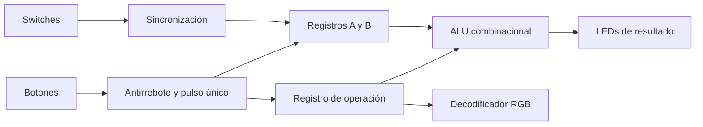

# Laboratorio 02 — ALU de 4 bits en Zybo Z7-10

Electrónica Digital II · Universidad Nacional de Colombia, sede Bogotá · 2026-2

| Integrante | Correo |
|---|---|
| Julián David Saavedra Pacheco | jusaavedrap@unal.edu.co |
| Juan Sebastián Cortés Gutiérrez | jcortesgu@unal.edu.co |
| Carlos Eduardo Matheus Quintero | cmatheus@unal.edu.co |

## Descripción general

El sistema implementa una unidad aritmético-lógica de 4 bits capaz de realizar suma, resta, AND y OR. Los operandos `A` y `B` y el código de operación se almacenan fuera de la ALU, mientras que `alu4` funciona exclusivamente como lógica combinacional.

Los switches forman un bus de datos compartido. Los botones permiten cargar de manera independiente cada operando y modificar los dos bits del código de operación. El resultado se muestra en los cuatro LEDs y el LED RGB identifica la operación seleccionada.

## Arquitectura y módulos

| Archivo | Función |
|---|---|
| [`src/alu4.v`](src/alu4.v) | Ejecuta las cuatro operaciones como lógica combinacional. |
| [`src/sync_inputs.v`](src/sync_inputs.v) | Sincroniza las entradas físicas con el reloj de la FPGA. |
| [`src/button_onepulse.v`](src/button_onepulse.v) | Filtra el rebote y genera un solo pulso por pulsación. |
| [`src/datapath_regs.v`](src/datapath_regs.v) | Almacena los operandos y el código de operación. |
| [`src/op_rgb.v`](src/op_rgb.v) | Asigna un color del LED RGB a cada operación. |
| [`src/lab02_top.v`](src/lab02_top.v) | Interconecta los módulos con switches, botones y LEDs. |

## Almacenamiento y control

`BTN0` carga el valor de los switches en el registro `A` y `BTN1` lo carga en el registro `B`. Los valores permanecen almacenados aunque los switches cambien. `BTN2` conmuta `op[0]` y `BTN3` conmuta `op[1]`; por ello, el código de operación se conserva después de soltar los botones.

La ALU no almacena operandos ni resultados. Su salida depende únicamente de los valores actuales de `A`, `B` y `op`.

## Operaciones e indicador RGB

| `op[1:0]` | Operación | Resultado de 4 bits | Color RGB | `{R,G,B}` |
|---|---|---|---|---|
| `00` | Suma | `(A + B) mod 16` | Verde | `010` |
| `01` | Resta | `(A - B) mod 16` | Rojo | `100` |
| `10` | AND bit a bit | `A & B` | Azul | `001` |
| `11` | OR bit a bit | `A \| B` | Amarillo | `110` |

La salida tiene cuatro bits, por lo que las operaciones aritméticas se interpretan módulo 16 y no generan banderas de acarreo, préstamo u overflow.

## Simulación

El banco [`sim/tb_alu4.v`](sim/tb_alu4.v) aplica las cuatro pruebas definidas para la práctica, en el orden suma, resta, AND y OR. Cada caso incluye una comprobación automática y la simulación finaliza con error si el resultado no coincide con el esperado.

| Orden | Operación | `op` | `A` | `B` | Resultado esperado |
|---:|---|---|---|---|---|
| 1 | Suma | `00` | `0101` | `0011` | `1000` |
| 2 | Resta | `01` | `0111` | `0101` | `0010` |
| 3 | AND | `10` | `0011` | `1001` | `0001` |
| 4 | OR | `11` | `0101` | `1010` | `1111` |

El ejecutable compilado es [`sim/tb_alu4.vpp`](sim/tb_alu4.vpp) y las formas de onda están en [`sim/tb_alu4.vcd`](sim/tb_alu4.vcd). En GTKWave se deben observar como mínimo `a`, `b`, `op` y `y`. Las fichas de cada prueba están en [`evidencias/`](evidencias/).

## Conclusiones

La separación entre los registros y la ALU permite conservar los operandos y la operación sin introducir estado en el bloque combinacional. Las cuatro pruebas dirigidas confirman el funcionamiento esperado de las operaciones requeridas y dejan las señales disponibles para su inspección en GTKWave.
