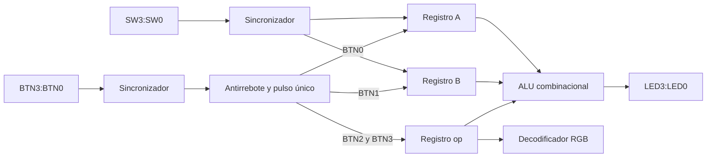

# Laboratorio 02 — ALU de 4 bits en Zybo Z7-10

Electrónica Digital II · Universidad Nacional de Colombia, sede Bogotá · 2026-2

| Integrante | Correo |
|---|---|
| Julián David Saavedra Pacheco | jusaavedrap@unal.edu.co |
| Juan Sebastián Cortés Gutiérrez | jcortesgu@unal.edu.co |
| Carlos Eduardo Matheus Quintero | cmatheus@unal.edu.co |

## Descripción general del sistema

El diseño implementa una unidad aritmético-lógica de cuatro bits capaz de efectuar suma, resta, AND y OR. Los switches de la tarjeta forman un bus de entrada compartido: primero se coloca un dato y se almacena como operando `A`; después se coloca un segundo dato y se almacena como operando `B`. Dos botones adicionales modifican y conservan el código de operación `op[1:0]`.

La ALU es combinacional y no almacena información. Los registros de operandos y de operación se encuentran en el datapath, fuera de la ALU. El resultado de cuatro bits se conecta a `LED[3:0]`, mientras que el LED RGB identifica la operación seleccionada.

## Arquitectura propuesta

Todas las partes secuenciales trabajan con el reloj de 125 MHz. Los switches y botones se sincronizan antes de usarse. Cada botón pasa por un filtro de antirrebote que produce un pulso de un ciclo, por lo que mantenerlo presionado no repite la acción. La ALU y el decodificador RGB son bloques combinacionales.

## Módulos desarrollados

| Archivo | Módulo y responsabilidad |
|---|---|
| [`src/alu4.v`](src/alu4.v) | `alu4`: calcula el resultado a partir de `A`, `B` y `op`. No contiene reloj ni elementos de almacenamiento. |
| [`src/sync_inputs.v`](src/sync_inputs.v) | `sync_inputs`: sincroniza las entradas asíncronas mediante dos etapas de flip-flops. Se usa para switches y botones. |
| [`src/button_onepulse.v`](src/button_onepulse.v) | `button_onepulse`: valida un nivel estable, filtra el rebote y genera un único pulso cuando se acepta una presión. |
| [`src/datapath_regs.v`](src/datapath_regs.v) | `datapath_regs`: almacena independientemente `A`, `B` y `op`. Solo cambia un registro cuando recibe su pulso de habilitación. |
| [`src/op_rgb.v`](src/op_rgb.v) | `op_rgb`: convierte el código de operación en el color `{rojo, verde, azul}`. |
| [`src/lab02_top.v`](src/lab02_top.v) | `lab02_top`: integra sincronizadores, filtros, registros, ALU y decodificador con los puertos físicos de la FPGA. |

## Almacenamiento de operandos y conservación de la operación

`BTN0` carga en `A` el valor sincronizado de `SW[3:0]`; `BTN1` realiza la misma acción sobre `B`. Después de la carga, mover los switches no modifica el registro: el operando permanece almacenado hasta que se acepta una nueva pulsación de su botón.

El código de operación también se guarda en flip-flops. `BTN2` conmuta `op[0]` y `BTN3` conmuta `op[1]`. Al soltar los botones el código no se borra, por lo que no es necesario mantenerlos presionados durante la operación. El reset interno de arranque inicializa `A`, `B` y `op` en cero.

## Operaciones implementadas e indicador RGB

| `op[1:0]` | Operación | Resultado `LED[3:0]` | Color | `{R,G,B}` |
|---|---|---|---|---|
| `00` | Suma | `(A + B) mod 16` | Verde | `010` |
| `01` | Resta | `(A - B) mod 16` | Rojo | `100` |
| `10` | AND bit a bit | `A & B` | Azul | `001` |
| `11` | OR bit a bit | `A \| B` | Amarillo | `110` |

La salida tiene cuatro bits. Por esta razón se descarta el acarreo de la suma y una resta negativa se representa en complemento a dos módulo 16. No se implementan banderas de acarreo, préstamo u overflow.

## Verificación mediante simulación

El banco [`sim/tb_alu4.v`](sim/tb_alu4.v) verifica el sistema integrado. Para cada prueba coloca el primer operando en `SW`, pulsa `BTN0`, coloca el segundo operando, pulsa `BTN1` y selecciona la operación con `BTN2` y `BTN3`. Además de generar ondas, el testbench compara automáticamente los registros, el resultado y el color RGB con los valores esperados.

En simulación se reduce `DEBOUNCE_CYCLES` a cuatro ciclos para observar las cargas sin ejecutar los 1.250.000 ciclos usados por la implementación. Esta reducción solo pertenece a la instancia del testbench y no modifica el valor sintetizable de hardware.

| Prueba | Operación | `op` | `A` | `B` | Resultado esperado | RGB esperado |
|---:|---|---|---|---|---|---|
| 1 | Suma | `00` | `0101` (5) | `0011` (3) | `1000` (8) | `010`, verde |
| 2 | Resta | `01` | `0111` (7) | `0101` (5) | `0010` (2) | `100`, rojo |
| 3 | AND | `10` | `0011` (3) | `1001` (9) | `0001` (1) | `001`, azul |
| 4 | OR | `11` | `0101` (5) | `1010` (10) | `1111` (15) | `110`, amarillo |

### Captura general de GTKWave

La señal `prueba` divide la simulación en las cuatro verificaciones. Las señales mostradas permiten seguir el recorrido completo de cada dato:

| Señal | Interpretación |
|---|---|
| `clk` | Reloj de 125 MHz que gobierna sincronizadores, filtros y registros. |
| `prueba` | Número de la prueba activa: 1 suma, 2 resta, 3 AND y 4 OR. |
| `SW[3:0]` | Dato que el testbench coloca en los switches. |
| `btn_cargar_a`, `btn_cargar_b` | Intervalo durante el cual se mantiene presionado `BTN0` o `BTN1`. |
| `pulso_carga_a`, `pulso_carga_b` | Pulso de un ciclo producido cuando el filtro acepta la pulsación. |
| `a[3:0]`, `b[3:0]` | Valores almacenados después de cada pulso de carga. |
| `op[1:0]` | Código de operación almacenado. |
| `rgb[2:0]` | Color asociado a `op`, en orden `{R,G,B}`. |
| `LED[3:0]` | Resultado combinacional de la ALU. GTKWave lo presenta en hexadecimal. |

En cada carga se observa primero el cambio de `SW`, luego el nivel alto del botón, después el pulso aceptado y finalmente el cambio de `a` o `b`. Los registros no siguen directamente a los switches: conservan su valor hasta la pulsación correspondiente.

`LED` puede mostrar valores intermedios mientras se preparan los operandos. Esto es correcto porque la ALU responde inmediatamente a los registros disponibles y al `op` que estuviera almacenado. Por ejemplo, durante la prueba 2 se observan `A` y `C` mientras se cargan 7 y 5 bajo la suma anterior; al cambiar `op` a `01`, el resultado definitivo pasa a `2` y el RGB a `100`. De forma análoga, la prueba AND termina en `1` y la prueba OR pasa por `0` antes de terminar en `F` hexadecimal.

El resultado final de la ejecución fue satisfactorio para las cuatro pruebas. Los archivos reproducibles son el testbench [`sim/tb_alu4.v`](sim/tb_alu4.v), el ejecutable [`sim/tb_alu4.vpp`](sim/tb_alu4.vpp) y las ondas [`sim/tb_alu4.vcd`](sim/tb_alu4.vcd).

## Evidencias de cada prueba

Cada ficha contiene la tabla de entradas y salidas, la captura recortada y una explicación del comportamiento observado.

| Prueba | Ficha | Captura |
|---:|---|---|
| 1 — Suma | [`evidencias/01_suma/README.md`](evidencias/01_suma/README.md) | [`gtkwave_suma.png`](evidencias/01_suma/gtkwave_suma.png) |
| 2 — Resta | [`evidencias/02_resta/README.md`](evidencias/02_resta/README.md) | [`gtkwave_resta.png`](evidencias/02_resta/gtkwave_resta.png) |
| 3 — AND | [`evidencias/03_and/README.md`](evidencias/03_and/README.md) | [`gtkwave_and.png`](evidencias/03_and/gtkwave_and.png) |
| 4 — OR | [`evidencias/04_or/README.md`](evidencias/04_or/README.md) | [`gtkwave_or.png`](evidencias/04_or/gtkwave_or.png) |

## Correspondencia con la implementación en FPGA

| Recurso físico | Función |
|---|---|
| `SW0`–`SW3` | Bus de datos de cuatro bits. |
| `BTN0` | Cargar el bus en `A`. |
| `BTN1` | Cargar el bus en `B`. |
| `BTN2` | Conmutar `op[0]`. |
| `BTN3` | Conmutar `op[1]`. |
| `LED0`–`LED3` | Mostrar el resultado de cuatro bits. |
| LED RGB | Identificar la operación mediante verde, rojo, azul o amarillo. |

La asignación concreta de estos recursos se encuentra en [`constraints/zybo_z7.xdc`](constraints/zybo_z7.xdc). Las capturas incluidas demuestran la simulación RTL del mismo flujo de switches, botones, registros, resultado y color que utiliza el módulo superior.

> **Alcance de la evidencia:** las imágenes suministradas son capturas de GTKWave y no fotografías de la tarjeta. Por tanto, verifican la simulación funcional, pero no sustituyen la evidencia visual de una FPGA programada. Para acreditar completamente la implementación física solicitada por la guía se debe añadir una fotografía o video de la Zybo Z7 ejecutando las cuatro pruebas; no se afirma una comprobación física que no haya sido documentada.

## Conclusiones

La arquitectura separa correctamente la lógica combinacional de los elementos de almacenamiento. Los operandos y el código de operación permanecen guardados después de mover los switches o soltar los botones, mientras que la salida se actualiza de forma combinacional. Las ondas confirman las cargas independientes, la permanencia de `op`, los cuatro resultados esperados y la correspondencia entre cada operación y su color RGB.
