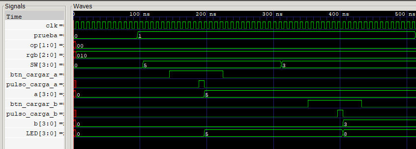

# Evidencia 1 — Suma

La señal `prueba=1` identifica la primera prueba de la secuencia.

| Señal o dato | Valor binario | Valor decimal / descripción |
|---|---:|---|
| Operación `op` | `00` | Suma |
| Color `rgb` | `010` | Verde |
| Entrada `A` | `0101` | 5 |
| Entrada `B` | `0011` | 3 |
| Salida esperada `LED` | `1000` | 8 |

## Captura de GTKWave

## Comportamiento observado

El testbench coloca primero `0101` en `SW`. Mientras `btn_cargar_a` permanece en alto, el filtro espera una pulsación estable; cuando aparece `pulso_carga_a`, el registro `a` cambia de `0000` a `0101`. Como `B` todavía vale cero y `op=00`, `LED` muestra inicialmente 5.

Después `SW` cambia a `0011` y se pulsa el botón de carga de B. El pulso `pulso_carga_b` hace que `b` cambie de `0000` a `0011`. La ALU suma inmediatamente los dos registros y `LED` pasa a `1000`, equivalente a 8. El código `op=00` se mantiene y `rgb=010` confirma el color verde.

## Evidencia física en video

[Ver o descargar el video de la prueba de suma](prueba_suma.mp4) — duración aproximada: 1 minuto y 10 segundos.

El video corresponde a la prueba 1 y permite contrastar la carga de los operandos con el resultado `1000` en los LEDs y el indicador verde asociado a `op=00`.
