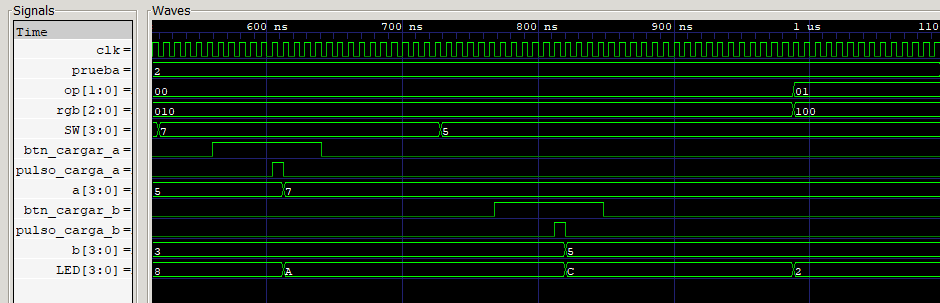

# Evidencia 2 — Resta

La señal `prueba=2` identifica la segunda prueba de la secuencia.

| Señal o dato | Valor binario | Valor decimal / descripción |
|---|---:|---|
| Operación `op` | `01` | Resta |
| Color `rgb` | `100` | Rojo |
| Entrada `A` | `0111` | 7 |
| Entrada `B` | `0101` | 5 |
| Salida esperada `LED` | `0010` | 2 |

## Captura de GTKWave

## Comportamiento observado

Con `prueba=2`, `SW` toma el valor 7 y la pulsación de carga actualiza `a` a `0111`. En ese momento todavía se conserva `B=3` y `op=00` de la prueba anterior, por lo que `LED` muestra temporalmente `A` hexadecimal: 7 + 3 = 10.

Luego se carga `B=0101`. Mientras la operación sigue siendo suma, el resultado transitorio es `C` hexadecimal: 7 + 5 = 12. Finalmente el selector cambia a `op=01`; `rgb` pasa de `010` a `100` y `LED` toma el valor definitivo `0010`, pues 7 − 5 = 2. Los valores transitorios evidencian el carácter combinacional de la ALU y no representan fallas.

## Evidencia física en video

[Ver o descargar el video de la prueba de resta](prueba_resta.mp4) — duración aproximada: 47 segundos.

El video corresponde a la prueba 2 y documenta la carga de 7 y 5, el resultado `0010` en los LEDs y el indicador rojo asociado a `op=01`.
