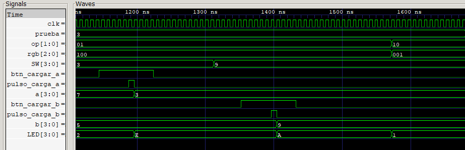

# Evidencia 3 — AND

La señal `prueba=3` identifica la tercera prueba de la secuencia.

| Señal o dato | Valor binario | Valor decimal / descripción |
|---|---:|---|
| Operación `op` | `10` | AND bit a bit |
| Color `rgb` | `001` | Azul |
| Entrada `A` | `0011` | 3 |
| Entrada `B` | `1001` | 9 |
| Salida esperada `LED` | `0001` | 1 |

## Captura de GTKWave

## Comportamiento observado

La prueba comienza conservando `op=01` y `B=5` de la resta. Al cargar `A=0011`, la salida responde con el resultado modular de 3 − 5. Después se coloca `1001` en `SW` y el pulso de carga actualiza `B` a 9; mientras continúa la resta, `LED` muestra `A` hexadecimal, correspondiente a 3 − 9 módulo 16.

Al seleccionar `op=10`, el indicador cambia a `rgb=001` y la ALU calcula `0011 & 1001 = 0001`. Por tanto, el valor definitivo mostrado en `LED` es 1 y el color asociado es azul.
