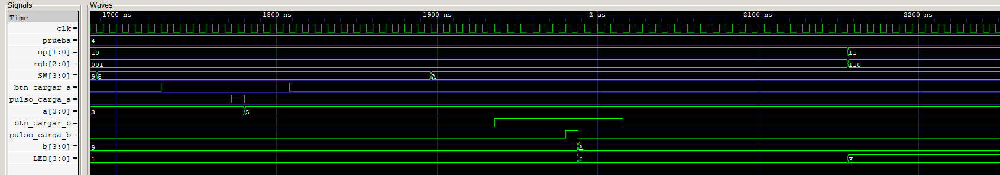

# Evidencia 4 — OR

La señal `prueba=4` identifica la cuarta prueba de la secuencia.

| Señal o dato | Valor binario | Valor decimal / descripción |
|---|---:|---|
| Operación `op` | `11` | OR bit a bit |
| Color `rgb` | `110` | Amarillo |
| Entrada `A` | `0101` | 5 |
| Entrada `B` | `1010` | 10 |
| Salida esperada `LED` | `1111` | 15 |

## Captura de GTKWave

## Comportamiento observado

La prueba empieza con `op=10`, `A=3` y `B=9`, por lo que se conserva inicialmente el resultado AND igual a 1. El valor `0101` se coloca en `SW` y se carga en `A`; después se coloca `1010` y se carga en `B`. Antes de cambiar de operación, la salida pasa a cero porque `0101 & 1010 = 0000`.

Finalmente `op` cambia de `10` a `11`. El bus RGB pasa de `001` a `110`, que corresponde al amarillo, y `LED` muestra `F` hexadecimal: `0101 | 1010 = 1111`. Este es el resultado final esperado para la cuarta prueba.

## Evidencia física en video

[Ver o descargar el video de la prueba OR](prueba_or.mp4)

El video corresponde a la prueba 4 y documenta la carga de 5 y 10, el resultado `1111` en los LEDs y el indicador amarillo asociado a `op=11`.
